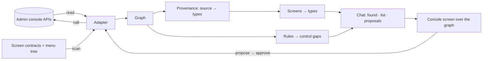

# XGEN Aegis

**A governance layer you plug into an admin console.** Aegis reads the console through one adapter, puts everything it
manages (users, agents, models, tools, approval rules, policies) into one graph, finds the control gaps, and lets an admin
work from a single chat box: ask, see the answer lit up in the graph, and open the console's own screen over the graph
with the fix already filled in. Nothing changes until a person approves it.

There is no hand-written menu or action table. Aegis learns the console's screens from the console:

- **Screens and menus** come from *screen contracts* (one small file per admin screen: title, route, and the API each UI
  element calls) and the console's menu tree.
- **Which screen manages which item type** is found by experiment: drop one API source, rebuild the graph, see which types
  change. A source that creates items of a type is its home; the screen that reads *and writes* that source is its management
  screen.
- **Actions** are the write APIs in the contracts (`PUT`, `POST`, `DELETE`), bound to an item by its key in the console.



## Try it

```bash
npm install
npm test                 # core and scan
npm run demo             # http://localhost:5288, a stand-in console with agents, models, users, approval rules
```

The demo console lives in the page (`examples/demo/host.ts`): its API handler, its screen contracts, its menu tree and its
adapter. Open *Approval › Approval rules*, turn on *Approval required* for `agent.share`, approve it, and watch the gap close.
Or ask *"which tools does Shell helper use"* and follow the proposal.

## Packages

| Package | What it does |
|---|---|
| `@xgen-aegis/core` | Graph, adapter contract, provenance, screen linking, actions and approval, rules, graph-only answers, export for the server. No dependencies. |
| `@xgen-aegis/scan` | Reads screen contracts and the menu tree from a git ref of the console's repo (the working tree is not touched). CLI `aegis-scan`. |
| `@xgen-aegis/react` | `<AegisApp adapter rules />`: the console's menu tree, the graph, the chat, and console screens opened over the graph. The parts (`AegisGraph`, `AegisChat`, `AegisScreen`) work on their own. |
| `server/` (`xgen-aegis-server`, Python) | OmniFuse search over the graph and LLM tool calling (any OpenAI-compatible endpoint). Read tools only; actions are proposed, never run. |

Packages ship TypeScript sources: use a bundler (Vite, webpack, esbuild), or Node 22.18+ which runs `.ts` directly.

## Plug it in

```ts
import type { HostAdapter } from '@xgen-aegis/core';
import { screensFromContracts } from '@xgen-aegis/scan';

export const adapter: HostAdapter = {
  // Read the same APIs the console's screens call. Keep the path each source came from.
  async read() {
    const urls = { agents: '/api/admin/agents/list', rules: '/api/admin/approval/rules' };
    const data = Object.fromEntries(await Promise.all(Object.entries(urls).map(async ([k, u]) => [k, await get(u)])));
    return { data, urls };
  },
  // Turn what was read into items and links. Give items a ref (source + key) so actions can address them.
  toGraph({ data }) {
    const items = data.agents.items.map((a) => ({ id: `agent:${a.id}`, type: 'Agent', title: a.name, props: { shared: a.shared }, ref: { source: 'agents', key: a.id } }));
    return { items, links: [] };
  },
  // The console's screens (or read them once with aegis-scan and load the JSON).
  async screens() { return screensFromContracts(CONTRACTS, MENU_TREE); },
  // Run an approved action. You know the console's API, so you build the request body.
  async call(method, path, input, action) { return send(method, path, bodyFor(action.operation, input)); },
  labels: { Agent: 'Agent' },
};
```

```tsx
import { AegisApp } from '@xgen-aegis/react';
import '@xgen-aegis/react/aegis.css';

<AegisApp adapter={adapter} rules={RULES} />
```

Rules are your governance policy, as code over the graph:

```ts
const RULES: Rule[] = [{
  id: 'share-without-approval', title: 'Agents on external models are shared without approval', severity: 'high',
  fix: 'Require approval before an agent is shared.', closeWith: ['Approval required'],
  check: (g) => g.ofType('Agent').filter((a) => a.props.shared && g.out(a.id, 'uses').some((m) => m.props.external)).map((a) => a.id),
}];
```

`closeWith` names the action label that closes the gap; the chat offers it on the affected items.

## Screen contracts

One per admin screen, next to the screen in the console's repo. Elements can sit anywhere in the object (under views, tabs);
every object with a `uiId` counts.

```ts
export default {
  featureId: 'approval-rules',
  title: 'Approval rules',
  route: '/admin?view=approval-rules',
  elements: [
    { uiId: 'rules', role: 'table', name: 'Rule table', permissions: ['admin.approval:read'],
      api: { method: 'GET', path: '/api/admin/approval/rules', operation: 'listRules' } },
    { uiId: 'required', role: 'switch', name: 'Approval required', permissions: ['admin.approval:manage'],
      api: { method: 'PUT', path: '/api/admin/approval/rules/{action}', operation: 'setRule' } },
  ],
};
```

The menu tree lists, per category and menu, the permission resources the menu guards. A screen is placed under the category
whose resources its elements use most, and named by its title.

```bash
aegis-scan path/to/console-repo --ref origin/main \
  --contracts "features/*/contracts/screen.contract.ts" \
  --taxonomy packages/permissions/src/menu.ts --taxonomy-export MENU \
  --out screens.json
```

## Search server

```bash
cd server && pip install -e ".[dev]" && pytest
node examples/demo/export-graph.ts graph.json        # or toSearchGraph(aegis, findings) from your own code
AEGIS_GRAPH=graph.json AEGIS_ORIGINS=http://localhost:5288 OPENAI_API_KEY=... python -m xgen_aegis_server.http
```

Then open the demo with `?server=http://localhost:7842`. `POST /ask` answers with the same shape as the graph-only answer
(`text`, `found`, `list`, `findings`, `proposals`); `POST /search` is OmniFuse alone. The graph file is re-indexed when it
changes. Questions are rate limited per IP and per day and are not logged. If the server is unreachable the chat answers from
the graph.

## Status

0.1. The core, scanner, React parts and server are tested (`npm test`, `pytest`) and the demo is checked end to end in a
browser. Not yet: approval lines with several approvers, audit history of proposals, and packaged npm/PyPI releases.

## License

Apache License 2.0. See LICENSE.md for details.
