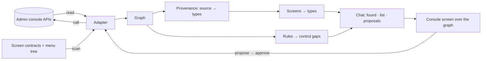

# XGEN Aegis

**AI governance, management and control in one ontology, done by chat.**

An AI platform spreads its governance over many admin screens: who may build and share agents, which models and tools they
use, what needs approval, token limits, policies, and what is failing right now. Aegis plugs into the platform's admin
console through one adapter and puts all of it into **one ontology**: users, roles, agents, models, tools, data, approval
rules, policies, and the platform's own health (services, error logs, alerts), linked to each other. An admin then works from
**one chat box** instead of hopping between screens:

- **Ask** anything about it ("which shared agents use an external model?", "why is Policy checker failing?", "is any service
  down?") and see the answer lit up in the graph, with what was found and the exact list.
- **Find gaps**: your governance rules run over the ontology and say what is open and what would close it.
- **Act**: an answer that can fix something shows the change itself (*Approval required: false → true*). Say "yes" (or press
  Apply) and a safe change with a decided value goes through; say "no" to drop it, or just say the other value ("make it off
  instead"). Anything that cannot be undone, or still needs a value, opens the console's own screen over the graph (80% of it)
  with the action filled in, and a person approves there. Nothing changes without a person saying so. An answer that finds a
  control gap but proposes nothing offers one **Fix it** button.
- **Diagnose** without reading server logs: error logs and alerts are items in the same ontology, linked to the agents they hit
  and the services they came from.

There is no hand-written menu or action table. Aegis learns the console's screens from the console:

- **Screens and menus** come from *screen contracts* (one small file per admin screen: title, route, and the API each UI
  element calls) and the console's menu tree.
- **Which screen manages which item type** is found by experiment: drop one API source, rebuild the graph, see which types
  change. A source whose rows are a type's items (it makes some of them, or changes most of them) is its home; a summary that
  only adds a count to a few items is not. The screen that reads *and writes* that source is its management screen. A list
  behind a filter or a picker (the owner dropdown on an agents page) does not put users on that page.
- **Every screen has something.** A screen the adapter does not read still has a list in its contract: with an optional
  `get(path)` Aegis reads it (GET only) and keeps the rows as items of that screen, with only safe columns (ids, numbers, flags,
  short words; no secrets, contact details, free text, names or bodies), rows keyed by their own id, and id columns linked to the
  items they point at. A list that repeats a resource another source already makes is dropped. A screen with nothing to list
  still shows up with its actions.
- **Actions** are every write API in every contract (`PUT`, `POST`, `DELETE`). One with a path param works on the rows of the
  type whose source is that resource (when a root source makes several types, the one named in the operation wins); the rest
  are actions on the screen itself.



## Try it

```bash
npm install
npm test                 # core and scan
npm run demo             # http://localhost:5288, a stand-in console with agents, models, users, approval rules
```

The demo console lives in the page (`examples/demo/host.ts`): its API handler, its screen contracts, its menu tree and its
adapter. Ask *"how many Agent"*, press **Fix it**, then say *"yes"*, and watch the gap close. Open *System › Audit log* (a
screen no adapter source reads: its list is read through `get`) or *System › Cache* (nothing to list, one action).
Or ask *"which tools does Shell helper use"* and follow the proposal, or *"why is Policy checker failing? error group"* to see
the failure trace to the error group and the service that is down.

## Packages

| Package | What it does |
|---|---|
| `@xgen-aegis/core` | Graph, adapter contract, provenance, screen linking, actions and approval, rules, graph-only answers, export for the server. No dependencies. |
| `@xgen-aegis/scan` | Reads screen contracts and the menu tree from a git ref of the console's repo (the working tree is not touched). CLI `aegis-scan`. |
| `@xgen-aegis/react` | `<AegisApp adapter rules />`: the console's menu tree, the graph, the chat, and console screens opened over the graph. The parts (`AegisGraph`, `AegisChat`, `AegisScreen`) work on their own. |
| `server/` (`xgen-aegis-server`, Python) | OmniFuse search over the graph and LLM tool calling (any OpenAI-compatible endpoint). Read tools only; actions are proposed, never run. |

Packages ship TypeScript sources: use a bundler (Vite, webpack, esbuild), or Node 22.18+ which runs `.ts` directly.

## Plug it in

```ts
import type { HostAdapter } from '@xgen-aegis/core';
import { screensFromContracts } from '@xgen-aegis/scan';

export const adapter: HostAdapter = {
  // Read the same APIs the console's screens call. Keep the path each source came from.
  async read() {
    const urls = { agents: '/api/admin/agents/list', rules: '/api/admin/approval/rules' };
    const data = Object.fromEntries(await Promise.all(Object.entries(urls).map(async ([k, u]) => [k, await get(u)])));
    return { data, urls };
  },
  // Turn what was read into items and links. Give items a ref (source + key) so actions can address them.
  toGraph({ data }) {
    const items = data.agents.items.map((a) => ({ id: `agent:${a.id}`, type: 'Agent', title: a.name, props: { shared: a.shared }, ref: { source: 'agents', key: a.id } }));
    return { items, links: [] };
  },
  // The console's screens (or read them once with aegis-scan and load the JSON).
  async screens() { return screensFromContracts(CONTRACTS, MENU_TREE); },
  // Run an approved action. You know the console's API, so you build the request body.
  async call(method, path, input, action) { return send(method, path, bodyFor(action.operation, input)); },
  // Optional: one GET, so Aegis can read the lists of screens read() does not cover.
  async get(path) { return get(path); },
  lists: { rows: 30, named: true },   // named: false numbers the rows instead of showing their names (for a public deployment)
  labels: { Agent: 'Agent' },
};
```

```tsx
import { AegisApp } from '@xgen-aegis/react';
import '@xgen-aegis/react/aegis.css';

<AegisApp adapter={adapter} rules={RULES} />
```

Logs and health are items like any other: read the console's log and status APIs in `read()` and turn them into, say,
`ErrorGroup` items (same level, exception and function) linked to the agents they hit and the services they came from, and
`Service` items with their health (see `examples/demo/host.ts`). The chat can then answer "why is this agent failing" from the
same graph, and the screen that reads those logs becomes their management screen like any other.

Rules are your governance policy, as code over the graph:

```ts
const RULES: Rule[] = [{
  id: 'share-without-approval', title: 'Agents on external models are shared without approval', severity: 'high',
  fix: 'Require approval before an agent is shared.', closeWith: ['Approval required'], closeValue: true,
  check: (g) => g.ofType('Agent').filter((a) => a.props.shared && g.out(a.id, 'uses').some((m) => m.props.external)).map((a) => a.id),
}];
```

`closeWith` names the action label that closes the gap and `closeValue` the value it is given; the chat offers it on the
affected items with that value, and asking about the gap by name ("Fix this: ...") answers with those proposals.

## Screen contracts

One per admin screen, next to the screen in the console's repo. Elements can sit anywhere in the object (under views, tabs);
every object with a `uiId` counts.

```ts
export default {
  featureId: 'approval-rules',
  title: 'Approval rules',
  route: '/admin?view=approval-rules',
  elements: [
    { uiId: 'rules', role: 'table', name: 'Rule table', permissions: ['admin.approval:read'],
      api: { method: 'GET', path: '/api/admin/approval/rules', operation: 'listRules' } },
    { uiId: 'required', role: 'switch', name: 'Approval required', permissions: ['admin.approval:manage'],
      api: { method: 'PUT', path: '/api/admin/approval/rules/{action}', operation: 'setRule' } },
  ],
};
```

The menu tree lists, per category and menu, the permission resources the menu guards. A screen is placed under the category
whose resources its elements use most, and named by its title.

```bash
aegis-scan path/to/console-repo --ref origin/main \
  --contracts "features/*/contracts/screen.contract.ts" \
  --taxonomy packages/permissions/src/menu.ts --taxonomy-export MENU \
  --out screens.json
```

## Search server

```bash
cd server && pip install -e ".[dev]" && pytest
node examples/demo/export-graph.ts graph.json        # or toSearchGraph(aegis, findings) from your own code
AEGIS_GRAPH=graph.json AEGIS_ORIGINS=http://localhost:5288 OPENAI_API_KEY=... python -m xgen_aegis_server.http
```

Then open the demo with `?server=http://localhost:7842`.

**Any AI.** The server talks to an OpenAI-compatible `/chat/completions` endpoint with tool calling: point `AEGIS_LLM_URL`,
`AEGIS_LLM_MODEL` and `AEGIS_LLM_KEY` at any provider or gateway that offers one (a hosted API, a self-hosted vLLM or Ollama
server, an LLM proxy). For anything else, pass your own function as `llm` to `xgen_aegis_server.ask(idx, question, llm=...)`:
it gets the messages and returns a chat completion. The model only reads through tools and proposes; Aegis keeps the facts,
the lists and the approvals, so swapping models does not change what is allowed. Without an LLM the chat still answers from
the graph (`ask` in `@xgen-aegis/core`).

The LLM is grounded before it starts: OmniFuse links the names in the question to items, and the types the question names are
passed with their real attributes and example values, so filters use the right spelling. Each action comes with its input kind
and the item's current value: a proposal carries the value to give, one that equals the current value is not made, and a
follow-up that only changes the value replaces the last proposal. A sentence that claims a proposal the model did not make is
dropped from the answer. `POST /ask` answers with the same shape as the graph-only answer
(`text`, `found`, `list`, `findings`, `proposals`); `POST /search` is OmniFuse alone. The graph file is re-indexed when it
changes. Questions are rate limited per IP and per day and are not logged. If the server is unreachable the chat answers from
the graph.

## Status

0.1. The core, scanner, React parts and server are tested (`npm test`, `pytest`) and the demo is checked end to end in a
browser (screen lists, an action-only screen, Fix it, yes / no in the chat, the 80% screen, question kept at the top). Not yet: approval lines with several approvers, audit history of proposals, and packaged npm/PyPI releases.

Next: from a diagnosed failure to a fix of the platform itself, in the same chat. An error group already knows its function,
endpoint and the agents it hits; linking it to the code that raises it would let Aegis propose a code change as one more
action that waits for approval.

## License

Apache License 2.0. See LICENSE.md for details.
